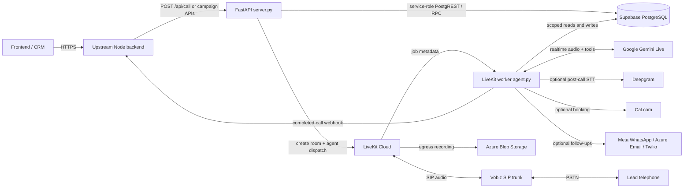
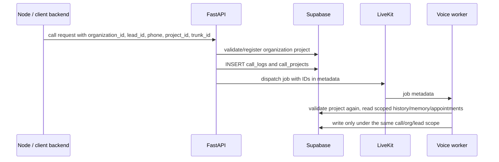
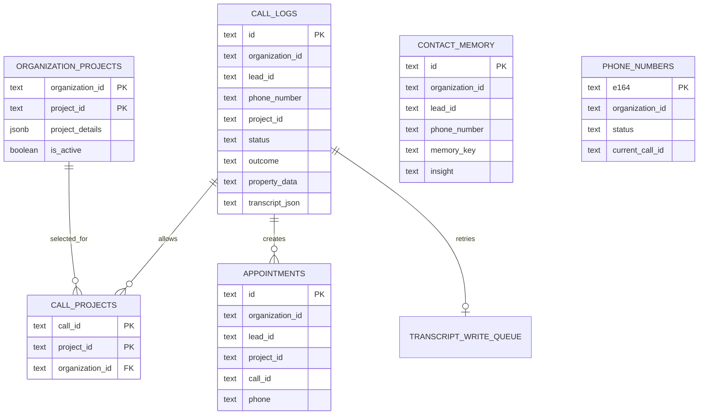
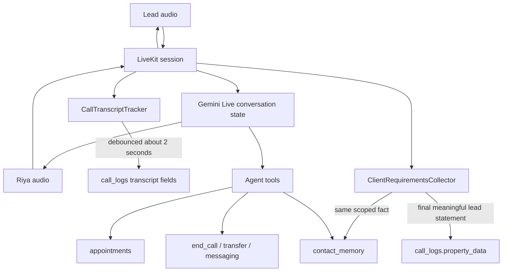

# OutboundAI system architecture

This document describes the architecture implemented by the current Python codebase. It is the source of truth for how the API backend, LiveKit worker, Supabase, telephony, AI model, recordings, and the upstream application connect.

## 1. System boundary



There are two Python processes:

| Process | Entrypoint | Responsibility |
|---|---|---|
| API service | `uvicorn server:app` | Validates requests, creates call records, verifies organization/project ownership, creates LiveKit rooms and dispatches jobs, runs campaigns, serves CRM APIs, and manages the phone pool. |
| Voice worker | `python agent.py start` | Accepts a LiveKit job, validates its metadata again, builds the prompt, leases a caller ID, dials the lead, runs the Gemini conversation, captures requirements/transcripts, invokes tools, finalizes the call, and hangs up. |

Both processes connect directly to Supabase through `db.py`. They do not pass database work through each other.

## 2. Configuration and credentials

Production secrets come from environment variables, not Supabase:

| Connection | Required configuration |
|---|---|
| Python to Supabase | `SUPABASE_URL`, `SUPABASE_SERVICE_KEY` |
| Python to LiveKit | `LIVEKIT_URL`, `LIVEKIT_API_KEY`, `LIVEKIT_API_SECRET` or explicitly supplied per-client LiveKit credentials |
| Worker to Gemini | client `gemini_api_key`, Gemini key pool, or configured Gemini key |
| LiveKit to Vobiz | the request's organization-specific `livekit_trunk_id`; Vobiz REST credentials are used to sync owned numbers |
| LiveKit egress to Azure | `AZURE_STORAGE_ACCOUNT`, `AZURE_STORAGE_KEY`, `AZURE_STORAGE_CONTAINER` |
| Completion callback | `CALL_COMPLETED_WEBHOOK_URL`, optionally `CALL_COMPLETED_WEBHOOK_SECRET` |
| Optional integrations | Deepgram, Cal.com, Meta WhatsApp, Azure Communication Services, and Twilio variables |

`db.py` creates one synchronous Supabase client for simple process-level checks and an asynchronous client per event loop for runtime database traffic. The service-role key bypasses database RLS, so authorization must be enforced by the API and by scoped queries.

## 3. Identity and tenant scope

Every new outbound call requires this identity tuple:

```text
organization_id + lead_id + phone_number + call_id
```

Project calls add:

```text
organization_id + project_id
```

The same telephone number may exist in several organizations because history and memory queries filter by `organization_id`, `lead_id`, and `phone_number`. Project data is resolved using `organization_id + project_id`, and the exact projects allowed for a call are persisted in `call_projects`.

The IDs travel through the system as follows:



The worker refuses a telephone job without `organization_id` or `lead_id`. It resolves projects with `register_missing=False`; therefore, job metadata cannot introduce a project that the API did not register first.

## 4. Supabase data model



### Table access matrix

| Table | Written by | Read by | Purpose and scope |
|---|---|---|---|
| `call_logs` | API at dispatch; worker throughout and at completion | API, worker, webhook and follow-up modules | Canonical call record. Stores tenant/lead/project IDs, state, outcome, duration, transcript, recording URL, callback fields, Gemini usage, and per-call `property_data`. Org/lead filters are supported by history APIs. |
| `organization_projects` | API call preparation with `register_missing=True` | API and worker | Verified project catalog per organization. After first trusted registration, stored database details override later request text. Inactive or cross-organization projects are rejected. |
| `call_projects` | API and worker | Database integrity layer | Exact allow-list of projects for a call. Its foreign keys require both the call and project to belong to the same organization. |
| `contact_memory` | Worker requirement collector and `remember_details` tool | Worker prompt prefetch and CRM tools | Long-term structured facts scoped by organization, lead, and phone. New confirmed values replace older values with the same `memory_key`. |
| `appointments` | Worker booking tool | Worker context and API | Booking/site visit record with organization, lead, project, and call IDs. The booking RPC prevents slot races. |
| `transcript_write_queue` | Worker transcript tracker after repeated write failure | Worker startup replay | Durable retry queue. It is normally empty; rows appear only when direct writes to `call_logs` fail three times. |
| `phone_numbers` | Vobiz sync and phone-pool lease/release logic | API and worker | Caller-ID pool. The atomic RPC prefers an organization-owned number, then a shared number, and never leases another organization's DID. |
| `campaigns` | Campaign API and scheduler | API scheduler | Campaign definition, serialized contacts, schedule, prompt, concurrency, and run totals. Currently global rather than organization-scoped. |
| `agent_profiles` | Profile API | API call preparation | Voice/model/prompt/tool presets. Currently global rather than organization-scoped. |
| `settings` | Local prompt/settings API and distributed job locks | API and worker | Local-development system prompt plus phone-sync/campaign locks. Production credentials are not stored here. |
| `error_logs` | API and worker | Logs API/dashboard | Operational diagnostics. |

### Core relational rules

- `organization_projects` primary key: `(organization_id, project_id)`.
- `call_projects` primary key: `(call_id, project_id)`.
- `call_projects(call_id, organization_id)` references `call_logs(id, organization_id)`.
- `call_projects(organization_id, project_id)` references `organization_projects(organization_id, project_id)`.
- `contact_memory` unique key: `(organization_id, lead_id, phone_number, memory_key)` when all scoped values exist.
- `phone_numbers` are leased atomically with `acquire_phone_number(...)` and `FOR UPDATE SKIP LOCKED`.
- `appointments` currently has one global booked-slot uniqueness rule on `(date, time)`.

## 5. Outbound call lifecycle

### 5.1 Request and dispatch

1. The upstream backend sends `POST /api/call`, `POST /api/batch-call`, or starts a campaign.
2. `ApiAuthMiddleware` validates the shared bearer/API key when `API_AUTH_TOKEN` is configured.
3. The API normalizes the telephone number and requires `organization_id`, `lead_id`, a Gemini key, and `livekit_trunk_id`.
4. The API resolves every requested project against `organization_projects`.
   - An unseen project may be registered only at this trusted API boundary and only when verified details are supplied.
   - A project ID already owned by another organization is rejected.
   - Existing database details override request-supplied project text.
5. The API inserts `call_logs` with `queued` or `ringing` state.
6. It inserts the verified call/project mappings into `call_projects`.
7. It creates a LiveKit room and dispatches the configured agent with JSON metadata containing the IDs, verified project catalog, trunk ID, lead source, prompt/profile overrides, and client credentials.

### 5.2 Worker startup and dialing

1. `agent.py` starts the LiveKit worker and delegates each job to `agent_runtime.py`.
2. The worker parses metadata and rejects missing organization or lead identity.
3. It verifies the project catalog against Supabase again without permission to register a new project.
4. It fetches call history, appointments, and contact memory concurrently, all within the same organization/lead/phone scope.
5. `prompting/builder.py` builds the immutable Gemini system prompt. Database-verified project details win over custom prompt project claims.
6. Transcript and requirement event handlers are attached before dialing.
7. The worker atomically leases an eligible caller ID from `phone_numbers`.
8. LiveKit creates the outbound SIP participant through the explicitly supplied organization trunk.
9. When answered, `call_logs` moves to `in_progress`, call duration starts, and Riya gives the identity-confirmation greeting.

### 5.3 During the call



- Gemini's live session keeps the immediate conversational context, so Riya can refer to details stated earlier in the same call.
- `ClientRequirementsCollector` deterministically extracts CRM facts from final customer transcripts. It writes each meaningful update asynchronously and serializes writes per call.
- Per-call facts go to `call_logs.property_data`; reusable facts go to scoped `contact_memory`.
- If the customer corrects a known structured field, the current value replaces the older scoped memory value.
- Transcript snapshots are written to `call_logs` after a short debounce. They do not block speech generation.
- Booking, lookup, memory, transfer, hangup, Cal.com, and messaging are exposed as model tools.

### 5.4 Completion or disconnection

For a normal model-directed ending:

1. Riya speaks or is forced to speak a short goodbye.
2. Pending requirement and transcript tasks are flushed.
3. `log_call()` calls `finalize_call()` and updates the existing `call_logs` row.
4. The final outcome, reason, duration, sentiment, callback time, transcripts, recording URL, and Gemini usage are stored.
5. The caller ID lease is released in `phone_numbers`.
6. The completed-call webhook and optional WhatsApp/email follow-ups are scheduled.
7. The LiveKit room is deleted, which ends the SIP call.

If the lead hangs up first, the worker's SIP disconnect handler performs the same flush/finalization path. A still-active record becomes `disconnect_in_between`; already-finalized outcomes are protected from being overwritten by the disconnect fallback.

## 6. Live data, cache, and persistence timing

| Data | Active-call location | Supabase timing | Final location |
|---|---|---|---|
| Conversation context | Gemini Live session | Not used for every model turn | Transcript in `call_logs` |
| Transcript lines | Worker memory | Debounced write approximately every 2 seconds, with retry | `call_logs.live_transcript` and `transcript_json` |
| Structured requirements | `ClientRequirementsCollector` task state | After each meaningful final lead statement | `call_logs.property_data` and scoped `contact_memory` |
| Outcome/callback | Tool arguments and transcript | Critical write on `end_call` or disconnect | `call_logs` |
| Caller-ID lease | Worker plus database row | Atomic at dial and released at finalization | `phone_numbers` |
| Project allow-list | Worker metadata | Before dial, then revalidated | `organization_projects` and `call_projects` |

This implementation does not use a Redis call-memory cache for requirements. Process memory and Gemini session state handle the active conversation, while Supabase is updated during the call. Redis is currently relevant to coordinating the Gemini key pool across replicas. If active call state must survive worker failure before a Supabase write finishes, a dedicated Redis state store can be added later.

## 7. Batch and campaign calling

- Every contact becomes its own `call_logs` row and LiveKit job.
- Parallelism is capped by the requested limit, eligible phone-number capacity, and normally Gemini key-pool capacity.
- Campaign FIFO mode keeps a fixed number of active slots. A slot waits for the prior call to reach a terminal state and for its caller ID to be released before taking the next lead.
- Every call has isolated worker objects, transcript tracker, requirements collector, `call_id`, phone, organization, and lead scope.
- Multiple calls can run in parallel; no call shares another call's in-process conversation state.

## 8. Backend read paths

| Consumer action | API/database path |
|---|---|
| Call list and detail | `/api/calls` and `/api/calls/{call_id}` read `call_logs` |
| Live transcript | `/api/calls/{call_id}/transcript` reads transcript fields from `call_logs` |
| Recording playback | `/api/calls/{call_id}/recording` reads the stored Azure URL and returns a signed URL/redirect |
| Lead CRM list | `/api/crm?organization_id=...` aggregates `call_logs` |
| One lead's history | `/api/crm/calls?organization_id=...&lead_id=...&phone=...` uses scoped `call_logs` queries |
| Appointments | `/api/appointments` reads `appointments` |
| Campaigns | `/api/campaigns` reads `campaigns` |
| Caller-ID state | `/api/numbers` and `/api/numbers/status` read `phone_numbers` |
| Usage and billing | `/api/gemini/tokens`, `/api/billing`, and `/api/stats` aggregate `call_logs` |

The upstream Node service should treat the completion webhook as the push signal and `call_logs`/read APIs as the recoverable source of truth. The webhook uses the Supabase `call_logs.id` as the external call ID.

## 9. Reliability behavior

- Transcript writes retry three times. If they still fail, the latest snapshot is upserted into `transcript_write_queue` and replayed by a later worker.
- `finalize_call()` prevents a stale cleanup or failure path from downgrading a real terminal outcome.
- The phone pool uses an atomic PostgreSQL function to avoid two parallel workers leasing the same number.
- Stale busy phone numbers and stale active calls are periodically reclaimed.
- Scheduler jobs use locks stored in `settings` to reduce duplicate work across API replicas.
- Requirement and transcript tasks are explicitly flushed before finalization.
- The worker validates project ownership even though the API already validated it, protecting against malformed or manually created LiveKit jobs.
- Credentials are redacted from validation and error responses.

## 10. Current production boundaries

The organization/project isolation added to the call path prevents accidental cross-organization project and lead-memory mixing in a trusted backend environment. The following items remain before strict hostile multi-tenant certification:

1. **Bind authentication to an organization.** `API_AUTH_TOKEN` is one shared token, while `organization_id` is accepted from the request. Use per-organization API keys or JWT claims and reject any body/query organization that does not match the authenticated tenant.
2. **Scope every administrative table.** Add `organization_id` and scoped CRUD to `campaigns` and `agent_profiles` if organizations must not see each other's definitions.
3. **Scope appointment uniqueness if appropriate.** The current unique booked-slot index is global `(date, time)`. Change it to include organization/resource/calendar when separate organizations may use the same slot.
4. **Protect every read endpoint.** Where a route accepts only `call_id` or appointment ID, validate that the authenticated organization owns the row before returning or mutating it.
5. **Enable database defense in depth.** RLS is disabled and the service-role key bypasses it. Keep that key only in the backend; optionally move to tenant-aware database functions/RLS with a non-service request role.
6. **Define shared-project policy.** A project ID is currently treated as globally exclusive to one organization. If a physical project can be sold by several organizations, use organization-specific project IDs or revise the ownership rule deliberately.

## 11. Deployment topology

```text
Azure Container App / process A
  uvicorn server:app --host 0.0.0.0 --port 8000

Azure Container App / process B
  python agent.py start

Shared managed services
  Supabase PostgreSQL
  LiveKit Cloud
  Google Gemini
  Vobiz SIP
  Azure Blob Storage
  Optional Redis for cross-replica Gemini key leases
```

The API and worker must use the same Supabase project and compatible LiveKit project/agent name. The upstream backend must always send `organization_id`, `lead_id`, the organization's `livekit_trunk_id`, and project IDs/details at the trusted registration boundary.

## 12. Code ownership map

| File | Role |
|---|---|
| `server.py` | REST API, validation, room dispatch, campaigns, CRM and phone-pool endpoints |
| `agent.py` | Stable LiveKit worker entrypoint |
| `agent_runtime.py` | Live job lifecycle, prompt/session setup, dial, VAD/silence behavior, disconnect handling |
| `db.py` | All Supabase table/RPC operations and tenant-scoped queries |
| `prompting/` | Prompt composition, mandatory behavior and verified project rules |
| `tools.py` | Agent-callable booking, memory, lookup, transfer, messaging and end-call tools |
| `transcripts.py` | Live transcript collection, debounce, retry queue and optional post-call STT |
| `client_requirements.py` | Deterministic extraction and persistence of lead requirements |
| `agent_context.py` | Scoped prior-contact and reconnect context |
| `phone_pool.py` | Vobiz number sync and stale lease reclamation |
| `call_webhook.py` | Completed-call payload and delivery to the upstream backend |
| `supabase_schema.sql` | Fresh-install database schema, indexes, constraints and RPC functions |

